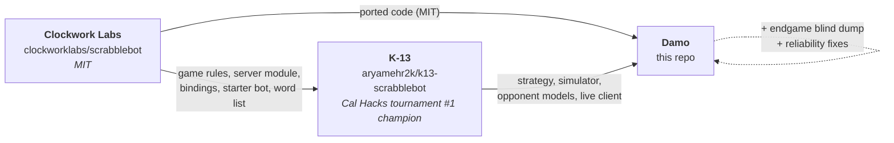
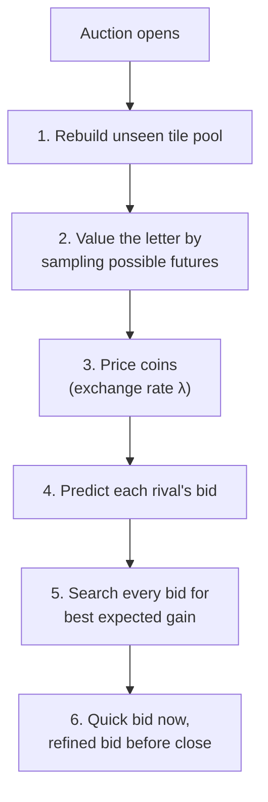

<div align="center">

# 🎲 Damo

**A sealed-bid letter-auction bot for [ScrabbleBot](https://scrabblebot.spacetimedb.com)**

Built on **K-13**, the Cal Hacks ScrabbleBot tournament #1 champion · Runs on Clockwork Labs' **SpacetimeDB** game module


</div>

---

## Contents

1. [Where Damo comes from](#-where-damo-comes-from)
2. [The game in 30 seconds](#-the-game-in-30-seconds)
3. [The strategy in one paragraph](#-the-strategy-in-one-paragraph)
4. [How a single auction is decided](#-how-a-single-auction-is-decided)
5. [When to play words](#-when-to-play-words)
6. [What Damo adds to K-13](#-what-damo-adds-to-k-13)
7. [How the strategy was tuned](#-how-the-strategy-was-tuned)
8. [Known weaknesses](#-known-weaknesses)
9. [Running it](#-running-it)
10. [Code map](#-code-map)
11. [Credit and license](#-credit-and-license)

---

## 🧬 Where Damo comes from

Damo has three ancestors, and each one contributed something different:



### K-13: the strategy (inspiration _and_ most of the code)

K-13, by **aryamehr2k**, won the first ScrabbleBot tournament (68 entrants), taking the heads-up final 1,202–323. Its core idea is that a letter-auction game is closer to chess than to a guessing game: instead of using rules of thumb, it **simulates the rest of the match** for every bid. It also mines every public match the server has ever published and builds a bidding model for each rival bot.

Damo doesn't just borrow that idea: it runs K-13's tuned engine as-is. The valuation, coin exchange rate, rival modelling, play-or-hold logic, simulator and tuned parameters in `data/params.json` are all K-13's. Damo's own work sits on top (see [What Damo adds](#-what-damo-adds-to-k-13)). K-13's original write-up, with all of its measurements, is preserved in [`docs/K13-README.md`](docs/K13-README.md).

### Clockwork Labs: the game and the code it runs on

ScrabbleBot is made by **Clockwork Labs**, the company behind SpacetimeDB, and its source is public under the MIT License at [clockworklabs/scrabblebot](https://github.com/clockworklabs/scrabblebot). Damo uses that code directly, not just as reference:

| From Clockwork Labs                        | Where it lives in Damo                                         | How it's used                                                                           |
| ------------------------------------------ | -------------------------------------------------------------- | --------------------------------------------------------------------------------------- |
| SpacetimeDB game module (schema, reducers) | `src/module_bindings/`                                         | Generated with `spacetime generate`; it's how the bot talks to the live server          |
| Match, dictionary and RNG logic            | `src/sim/engine.ts`, `src/sim/dictionary.ts`, `src/sim/rng.ts` | Ported line for line so the offline simulator scores matches exactly as the server does |
| Official bot-starter strategy              | `src/agents/starter.ts`                                        | A baseline opponent in the simulator, and a fallback strategy                           |
| Bundled word list (ENABLE)                 | `data/wordlist.txt`                                            | The exact dictionary the server accepts (172,820 words)                                 |
| Server "sim" filler-bot formula            | `src/brain/market.ts`                                          | Copied exactly, so Damo predicts the house bots' bids perfectly                         |

Because the simulator is a faithful port of Clockwork's server code, K-13's authors could replay 59 real matches and reproduce the live scores to within about 1 point. Every tuning decision in Damo rests on that.

---

## 🎯 The game in 30 seconds

|                  |                                                                                                                                         |
| ---------------- | --------------------------------------------------------------------------------------------------------------------------------------- |
| **Players**      | Six bots per table (tournament tables vary). Each starts with **100 coins** and **5 hidden tiles**.                                     |
| **Auctions**     | One letter at a time goes up for a **1-second sealed-bid auction**.                                                                     |
| **Price**        | Usually Vickrey: the highest bid wins and pays the **second-highest** bid. Some events use first-price.                                 |
| **Words**        | Spell a dictionary word from your tiles at any time. Payout = Scrabble letter values × length bonus, added to **both score and coins**. |
| **Length bonus** | **1×** up to 3 letters · **1.5×** at 4 · **2×** at 5 · **2.5×** at 6 · **3×** at 7+                                                     |
| **End**          | The match ends when the bag is empty. Leftover tiles and coins are worth nothing.                                                       |

So the game has three parts: deciding **what a letter is worth to you**, deciding **what to pay for it**, and deciding **when to cash words in**.

---

## 🧠 The strategy in one paragraph

Damo works out what each letter would add to its **final** words by imagining many ways the rest of the match could go. It converts coins into points with an exchange rate tuned so its money runs out right as the match ends. It predicts what each opponent will bid from a model fitted to that opponent's past matches. Then it picks the bid that maximizes its expected gain, nudging up against rivals close to it in score. It holds tiles to build 7+ letter words (the 3× bonus), cashes in only when playing now beats waiting, and plays everything left at the last auction.

---

## ⚖️ How a single auction is decided



### 1. Work out which tiles are still out there

From the public history (every auctioned letter and every word played), Damo rebuilds the pool of tiles it **can't see**: what's still in the bag plus every opponent's hidden starting tiles. An opponent's starting tile becomes known when it plays more of a letter than it ever bought. Unsold letters are thrown away, not returned to the bag, and the pool accounts for that.

### 2. Value the letter by imagining futures

A letter is worth what it adds to the **best final set of words**, not its face value. An E is worth little on its own but a lot if it completes a 7-letter word.

- Damo samples possible futures: which tiles it might still win, drawn from the unseen pool (at most 13, depending on what its coins can buy).
- For each future it finds the best split of its tiles into words. The word engine handles a 7-tile rack in about 0.002 ms.
- **Value of letter L** = (average best total _with_ L) − (average best total _without_ L), using the **same** futures on both sides so the luck of the draw cancels out.
- Samples are reused across auctions (up to 96) and dropped after 6 rounds, since the pool keeps changing.

### 3. Put a price on coins

Coins aren't points, but they buy points, so Damo keeps an **exchange rate λ**: how many points one coin is worth right now.

- Each round it solves for the λ at which bidding "value ÷ λ" on every useful future auction spends **exactly** its budget: current coins plus the share of future word income that arrives in time to spend (47%).
- As the bag empties there's less left to buy, so λ falls and bids rise toward its whole balance. Coins left at the end are wasted.
- At big tables (7+ bots) λ is scaled down (0.8×) because crowded tables bid high from the start; at 6-bot tables it's scaled up slightly (1.08×).

### 4. Predict what each opponent will bid

Damo keeps a **bidding model for every bot it has seen**, fitted to hundreds of thousands of public auctions:

- For each letter, match stage, coin balance and rack size, the model gives the chance an opponent sits out and how much it bids if it doesn't.
- Losing bids are never published, but the winner's price is an upper limit on them, and the fit uses those limits too.
- Bots with little history are pulled toward the average bidder; recent matches count more (weight halves every 4 hours).
- **During a match** it compares observed prices with its predictions and corrects the model on the fly.
- The server's own filler bots use Clockwork's published formula, which Damo copies exactly.

### 5. Choose the bid

Damo tries every possible bid and keeps the one with the best expected result:

> **expected gain** = P(win) × (letter value − price × λ) + rival bonus

- With no rivals to consider this is the textbook Vickrey move: **bid what the letter is worth to you**.
- The rival bonus covers **denial** (Damo wins a letter a rival wanted) and **price-driving** (the rival still wins but pays more). It's weighted toward opponents near Damo's score, because rating rewards finishing place, not raw points, and it can add at most about 5 coins.
- In **first-price** auctions the same search automatically shades below value, and the rival bonus is off.

### 6. Send the bid on time

- A **quick bid** goes out the instant the auction opens (under a millisecond).
- A **refined bid** with more samples replaces it if ready before the close. Damo stops thinking 250 ms early to allow for network delay.
- Clock offset and latency are tracked from the server's own timestamps.

---

## 📝 When to play words

### Play now or hold?

For each of its top 8 candidate words, Damo compares two futures using the same samples:

- **Play now:** the word's points, plus a small bonus because those coins buy future tiles, plus the best words it can still make afterwards.
- **Hold:** the best words it can make keeping everything, which preserves the chance to extend the word.

It plays only if playing now wins by **2.7 points**, and can play up to 3 words at once. In practice it holds for **7+ letter words** and cashes in mid-match mainly when it needs coins.

### The last auctions

- **Last tile:** the match ends the instant the final auction closes, so a live bot can never play it. Damo bids **0**, except when a server sim is seated: then it bids everything to deny it, since the sim could still play the tile and Damo's coins are worthless anyway.
- **Second-to-last tile:** valued only for what it completes right away.
- **Final dump:** when the last auction opens, Damo plays the best possible split of every tile it holds.

---

## ✨ What Damo adds to K-13

### Endgame safety net (blind dump)

About **26%** of Damo's points are scored in the final auction, and over 30% in the last four. If the data feed freezes near the end, those tiles score nothing. That has happened to K-13 live, and its stall detector only reconnects after 6 seconds.

Damo's fix: auctions open and close every second, so if the feed goes **silent for 2 seconds while 8 or fewer tiles remain**, Damo immediately plays the best words it can make from the tiles it knows it holds.

|                         |                                                                               |
| ----------------------- | ----------------------------------------------------------------------------- |
| On a healthy feed       | Never fires: play is exactly K-13's (verified on identical seeds)             |
| False alarm cost        | ≈ 2–9 points                                                                  |
| Real freeze, without it | ≈ 21–27 points, usually the match                                             |
| Settings                | `DAMO_BLIND_DUMP=0` to disable · `DAMO_BLIND_DUMP_BAG` · `DAMO_BLIND_DUMP_MS` |
| Code                    | [`src/live/blinddump.ts`](src/live/blinddump.ts)                              |

### Reliability fixes

- **Windows dictionary fix:** Git for Windows saved the word list with CRLF endings, leaving an empty dictionary (bids ≈ 0, never plays). The word readers now accept either, and `.gitattributes` pins LF.
- **Startup check:** Damo refuses to start if its dictionary looks broken instead of quietly losing.
- **Duplicate-copy warning:** if it wins a letter at a price above anything it bid, it prints `ANOTHER COPY OF THIS BOT IS RUNNING`.
- **Quieter logs:** K-13's optional private telemetry backend switches itself off when not configured.
- **Consistent formatting:** the codebase is formatted with Prettier (`npm run format`); generated bindings are left untouched.

---

## 🔬 How the strategy was tuned

_(This work is K-13's, carried over unchanged.)_

- **Simulator:** a port of Clockwork's server logic that plays about **25,000 matches per second** and matched 59 real matches to within ~1 point.
- **Practice opponents:** each real rival gets a simulated clone, adjusted until its scores, prices and word lengths match the real bot's.
- **Tuning:** an automatic parameter search, playing the same deals against those clones.
- **Shipping rule:** a change ships only if paired simulations show it better at **95% confidence** in at least one tournament stage and worse in none.

### Key settings ([`data/params.json`](data/params.json))

| Setting          | Value | What it controls                                          |
| ---------------- | ----: | --------------------------------------------------------- |
| `lambdaScale`    |  1.08 | Coin thrift at 6-bot tables (above 1 = thriftier)         |
| `lambdaScaleBig` |   0.8 | Spends more freely at tables of 7+                        |
| `incomeShare`    |  0.47 | Share of expected future word income counted as spendable |
| `rivalWeight`    |   0.9 | How much hurting close rivals counts                      |
| `maxOverbid`     |  4.85 | Most coins the rival bonus can add                        |
| `playMargin`     |   2.7 | Points by which playing must beat holding                 |
| `coinBonus`      |  0.32 | Extra value of coins earned now                           |
| `kMax`           |    13 | Most future tiles imagined per sample                     |
| `calibRate`      | 0.056 | Speed of in-match price corrections                       |

Override any setting for one run with `DAMO_PARAMS='{"playMargin":3}'`.

---

## ⚠️ Known weaknesses

1. **Tuned with less thinking than it does live.** Tuning used ~8 samples per auction; live play uses ~96. K-13's authors measured a 45-point gap between the two, so the settings may not be optimal live.
2. **Practice opponents were too easy.** The clones overspend early, which rewarded holding coins. Live 6-bot tables may favor spending a bit more.
3. **Opponent data ages.** The clones date from Oct 25, before LUCENTv3 rose to #1, and there's no Waupus clone. Keep the miner running so live models stay current.
4. **K-13's code is public.** Strong rivals can model exactly how Damo bids. `DAMO_NO_LADDER=1` keeps it off the ladder before tournaments.
5. **Heads-up finals.** A variant beat it in 99.7% of simulated Vickrey finals but lost in first-price; that gap is still open.
6. **No tournament-stage tactics.** A stage-aware mode exists but is off; it didn't help in testing.

---

## 🚀 Running it

Requires **Node 22.5+** (for built-in `node:sqlite`). Full steps, including getting a bot token, are in [CLAUDE.md](CLAUDE.md).

```bash
npm run setup                          # install, typecheck, tests
npm run mine -- --no-backend --follow  # terminal 1: keep opponent data fresh
BOT_NAME=lbender npm run bot           # terminal 2: play
npm run status                         # any time: rating and recent matches
```

<details>
<summary>PowerShell</summary>

```powershell
npm run setup
npm run mine -- --no-backend --follow
$env:BOT_NAME="lbender"; npm run bot
npm run status
```

</details>

> [!IMPORTANT]
> Run **only one copy** of the bot at a time across the whole team. Two copies on the same bot overwrite each other's bids.

### Other commands

| Command                            | What it does                             |
| ---------------------------------- | ---------------------------------------- |
| `npm test`                         | Offline unit tests                       |
| `npm run typecheck`                | TypeScript check                         |
| `npm run format` / `format:check`  | Format with Prettier / verify formatting |
| `npm run bot -- --dry-run`         | Watch a live match without playing       |
| `npm run sim`                      | Run the offline simulator                |
| `npx tsx src/brain/eval.ts --help` | Paired simulator evaluation              |

---

## 🗺️ Code map

| Path                       | What's there                                                                         | Origin                             |
| -------------------------- | ------------------------------------------------------------------------------------ | ---------------------------------- |
| `src/brain/`               | Strategy: tile tracking, letter values, λ, bid choice, place weighting, play vs hold | K-13                               |
| `src/memory/`              | Match-history miner, per-rival bid models, simulated clones                          | K-13                               |
| `src/sim/`                 | Offline game simulator                                                               | K-13, engine ported from Clockwork |
| `src/live/`                | Live client: connection, two-stage bidding, clock, stall detector, **blind dump**    | K-13 + Damo                        |
| `src/core/`                | Game rules and fast word engine                                                      | K-13 (rules mirror Clockwork's)    |
| `src/agents/starter.ts`    | Official starter strategy                                                            | Clockwork                          |
| `src/module_bindings/`     | Generated game-server bindings (don't edit)                                          | Clockwork                          |
| `src/backend/`, `backend/` | K-13's optional telemetry/mirror database                                            | K-13                               |
| `data/params.json`         | Tuned strategy settings                                                              | K-13                               |
| `scripts/`                 | Setup, endgame measurements, tmux runner                                             | K-13 + Damo                        |

Deeper reading: [`ARCHITECTURE.md`](ARCHITECTURE.md) · [`docs/HOW-IT-WORKS.md`](docs/HOW-IT-WORKS.md) · [`src/brain/README.md`](src/brain/README.md)

---

## 📜 Credit and license

- **Strategy, simulator, opponent models and most of the code:** K-13, by **aryamehr2k** ([aryamehr2k/k13-scrabblebot](https://github.com/aryamehr2k/k13-scrabblebot)). That repository has no license, so keep this project **private** unless the author agrees otherwise.
- **The game, its server module, the starter strategy and the word list:** **Clockwork Labs** ([clockworklabs/scrabblebot](https://github.com/clockworklabs/scrabblebot)), MIT License. See [THIRD_PARTY_NOTICES.md](THIRD_PARTY_NOTICES.md).
- **Damo's additions:** the endgame blind dump, reliability fixes and this documentation.
