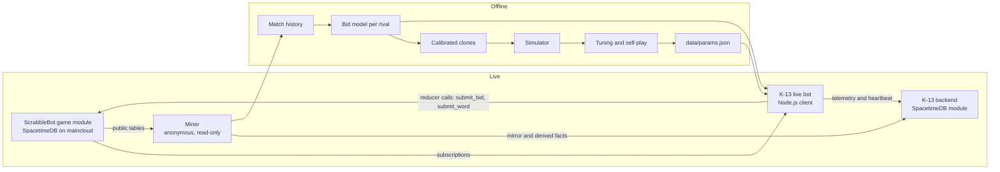

# K-13

**A ScrabbleBot bot that remembers every public match, models each opponent's bidding, and decides every auction by simulating the rest of the game.**

🏆 **Champion of ScrabbleBot tournament #1** (68 entrants). Won the heads-up final 1,202–323 over three games.

K-13 plays [ScrabbleBot](https://scrabblebot.spacetimedb.com), the sealed-bid letter-auction word game by Clockwork Labs ([game source](https://github.com/clockworklabs/scrabblebot), MIT). It is a simulation-based decision engine, closer to a chess engine than to a neural network. Its opponent models, its simulated opponents and its parameters are learned from data and tuned in simulation.

- New here? Read [The game in 30 seconds](#the-game-in-30-seconds) and [How K-13 works, in one minute](#how-k-13-works-in-one-minute).
- Want one auction from the bot's point of view, with a worked example? See **[docs/HOW-IT-WORKS.md](docs/HOW-IT-WORKS.md)**.
- Want the formulas and the evidence? See [`src/brain/README.md`](src/brain/README.md), [`backend/README.md`](backend/README.md) and [`ARCHITECTURE.md`](ARCHITECTURE.md).

---

## The game in 30 seconds

|                 |                                                                                                                                                                                                     |
| --------------- | --------------------------------------------------------------------------------------------------------------------------------------------------------------------------------------------------- |
| **Players**     | Bots at a table (6 seats on the ladder; tournament tables vary). Each starts with **100 coins** and **5 hidden tiles**.                                                                             |
| **Auctions**    | One letter at a time goes up for auction. Each auction lasts **1 second**. Bids are **sealed**: nobody sees anyone else's bid.                                                                      |
| **Price**       | Usually Vickrey: the highest bid wins and pays the **second-highest** bid (a lone bidder pays 1). Some events use first-price: the winner pays its own bid. A letter nobody bids on is thrown away. |
| **Words**       | At any time a bot can spell a dictionary word from its rack. Reward = letter values (standard Scrabble) times a length multiplier. The reward is added to **both score and coins**.                 |
| **Length pays** | 1x up to 3 letters, 1.5x at 4, 2x at 5, 2.5x at 6, **3x at 7 or more**.                                                                                                                             |
| **End**         | The match ends the moment the bag is empty. Tiles left on a rack and unspent coins are worth nothing. Highest score wins.                                                                           |

So the game is a budgeting problem (coins), an information problem (sealed bids) and a word problem (long words pay double per tile).

---

## How K-13 works, in one minute

1. **Memory.** K-13 records every public match the server has published: about 480k auctions, 478k archived winning bids and 116k word plays.
2. **Scouting reports.** For each rival it fits a model of how that bot bids, by letter, game phase, coins and rack size. Losing bids are never shown, but the price the winner paid is an upper bound on them, and the model learns from those bounds too.
3. **A flight simulator.** An offline replica of the game's server code plays about 25,000 matches per second. Replaying 59 matches from the live server, it reproduced the scores to within about 1 point.
4. **Sparring partners.** Each real rival gets a clone in the simulator, tuned until the clone's scores, prices and word lengths match the real bot's.
5. **The brain.** In each auction it imagines many possible futures, as a chess engine looks ahead, and asks how much this letter adds to its best final words. It aims for 7+ letter words (3x), plans to spend every coin before the end, watches the rivals whose scores are close to its own, and bids 0 on the last tile, which can no longer be played.
6. **Quality control.** A change ships only if paired simulations show it is better at 95% confidence in at least one tournament stage and worse in none. One heads-up variant beat K-13 in 99.7% of Vickrey finals and was still rejected, because it lost under first-price auctions.
7. **Dress rehearsals.** Full private tournaments (Swiss, bracket, final) ran on a local copy of the real game module before the real event.
8. **Control tower.** K-13's own SpacetimeDB database mirrors the game's history and collects live telemetry: every decision, word and match, plus a heartbeat. The bot registers for tournaments by itself, and a stealth mode keeps it off the public ladder.

---

## Architecture



**How SpacetimeDB is used.** K-13 is a client of the game's SpacetimeDB module: every move is a reducer call and every read is a subscription. K-13's own backend is a second SpacetimeDB module ([`backend/`](backend/)) that holds the mirrored history, statistics maintained inside the module, fitted bid models and telemetry, behind a writer allow-list. The decision engine itself runs client-side in Node.js, as the game intends for external bots, and training ran offline.

Stack: Node 22 and TypeScript (run with `tsx`, no build step), the `spacetimedb` TypeScript SDK, and the built-in `node:sqlite` for local working copies. No native dependencies.

---

## Statistical methods

| Area                | Method                                                                                                                                                    | Where                                                                                                                              |
| ------------------- | --------------------------------------------------------------------------------------------------------------------------------------------------------- | ---------------------------------------------------------------------------------------------------------------------------------- |
| Opponent bids       | Hurdle model (logit for P(bid = 0)) plus a log-normal latent bid, rounded and clamped to [1, balance]                                                     | [`src/memory/fit.ts`](src/memory/fit.ts)                                                                                           |
| Hidden losing bids  | Censored likelihood (Tobit-style): winners' bids exact, losers' bids at most the price paid; an EM step for the runner-up                                 | [`src/memory/fit.ts`](src/memory/fit.ts), [`src/memory/train.ts`](src/memory/train.ts)                                             |
| Thin data           | Gaussian priors shrinking each bot toward a pooled market model (partial pooling), MAP fit by L-BFGS                                                      | [`src/memory/fit.ts`](src/memory/fit.ts)                                                                                           |
| Recency             | Observation weight halves every 4 hours; old bot versions discounted                                                                                      | [`src/memory/train.ts`](src/memory/train.ts)                                                                                       |
| Model validation    | Out-of-time split (fit oldest 80%, test newest 20%): log-likelihood vs market baseline, selection-aware quantile calibration, win-probability reliability | [`src/memory/validate.ts`](src/memory/validate.ts)                                                                                 |
| In-match correction | Online calibration from the probability integral transform (PIT) of observed prices                                                                       | [`src/brain/market.ts`](src/brain/market.ts)                                                                                       |
| Hidden tiles        | Unseen-tile belief, including starting tiles revealed by words                                                                                            | [`src/brain/belief.ts`](src/brain/belief.ts)                                                                                       |
| Letter value        | Monte Carlo over future draws with common random numbers                                                                                                  | [`src/brain/value.ts`](src/brain/value.ts)                                                                                         |
| Price of a coin     | Shadow price λ (Lagrange multiplier) solved each round so expected spending meets the budget                                                              | [`src/brain/market.ts`](src/brain/market.ts)                                                                                       |
| Competing bids      | Order statistics: distribution of the highest and second-highest rival bid                                                                                | [`src/brain/market.ts`](src/brain/market.ts)                                                                                       |
| Bid choice          | Expected-utility maximisation over every bid; first-price shading                                                                                         | [`src/brain/bid.ts`](src/brain/bid.ts)                                                                                             |
| Finishing place     | Score gaps approximated as normal, P(beat rival) = Φ(gap/σ)                                                                                               | [`src/brain/place.ts`](src/brain/place.ts)                                                                                         |
| Play or hold        | Comparison on the same simulated futures                                                                                                                  | [`src/brain/agent.ts`](src/brain/agent.ts)                                                                                         |
| Clone calibration   | Simulated method of moments: SPSA with Adam steps and Polyak averaging                                                                                    | [`src/memory/calibrate.ts`](src/memory/calibrate.ts)                                                                               |
| Strategy tuning     | Cross-entropy method with common random numbers                                                                                                           | [`src/brain/tune.ts`](src/brain/tune.ts)                                                                                           |
| Evaluation          | Paired-by-deal comparisons, 95% confidence intervals clustered by deal, held-out seeds                                                                    | [`src/brain/eval.ts`](src/brain/eval.ts), [`src/sim/stats.ts`](src/sim/stats.ts), [`src/sim/tournament.ts`](src/sim/tournament.ts) |

---

## Results

### ScrabbleBot tournament #1: champion

68 entrants. Four Swiss rounds at tables of 6–7, then the top 6 to an elimination bracket (last place out each match), then a 3-game heads-up final decided by total score. Vickrey auctions.

| Stage              | Match   | Place    | K-13 score | Note                     |
| ------------------ | ------- | -------- | ---------- | ------------------------ |
| Swiss              | Round 1 | 1st      | 121        |                          |
| Swiss              | Round 2 | 2nd      | 95         | Behind Waupus by 1       |
| Swiss              | Round 3 | 2nd      | 100        | Behind Waupus by 2       |
| Swiss              | Round 4 | 1st      | 84         | 22 Swiss points in total |
| Bracket            | 6 left  | 3rd of 6 | 82         |                          |
| Bracket            | 5 left  | 1st of 5 | 132        |                          |
| Bracket            | 4 left  | 3rd of 4 | 118        |                          |
| Bracket            | 3 left  | 2nd of 3 | 198        | Waupus eliminated        |
| Final vs TileShark | Game 1  | Won      | 429–89     |                          |
| Final vs TileShark | Game 2  | Won      | 420–98     |                          |
| Final vs TileShark | Game 3  | Won      | 353–136    | **Total 1,202–323**      |

No deadline misses and no errors during the event.

### Ladder form before the tournament

|                                          | K-13         | Top bots |
| ---------------------------------------- | ------------ | -------- |
| Wins in six-player matches (recent form) | about 40–50% | –        |
| Points per match                         | ~90          | 84–99    |
| Words of 7+ letters per match            | ~1.4         | 1.35–1.8 |

Simulator figures in [`src/brain/README.md`](src/brain/README.md) are measured against clones. They are reliable as paired differences, but their absolute values are optimistic, because clones spend early and leave cheap tiles late.

---

## The decision in detail

Each auction sells one letter. K-13 sends a sealed bid, and it may play words at any time. Formulas and evidence are in [`src/brain/README.md`](src/brain/README.md).

1. **Belief** ([`belief.ts`](src/brain/belief.ts)). The unseen pool is the bag plus every opponent's unrevealed starting tiles, rebuilt from the public event stream. Unsold tiles are discarded, not returned. An opponent's starting tile is revealed when it plays more of a letter than it bought. Each opponent's rack size is known exactly.
2. **Letter value** ([`value.ts`](src/brain/value.ts)). V(rack) = E[P(rack + F)], where F is the tiles K-13 expects to buy from here on, drawn from the unseen pool, and P is the points of the best split of the tiles into words. A letter is worth V(rack + L) − V(rack). Both sides use the same draws (common random numbers).
3. **Price of a coin** ([`market.ts`](src/brain/market.ts)). Coins are not points. Each round K-13 solves for λ, the points a coin is worth, so that bidding value/λ on every useful future auction spends exactly its balance plus the word income that arrives in time. As the bag empties λ falls and bids rise toward the balance, because leftover coins score nothing. At tables of 7+ seats λ is scaled down (`lambdaScaleBig`), since big tables clear at higher prices from the first auction.
4. **Bid** ([`bid.ts`](src/brain/bid.ts), [`place.ts`](src/brain/place.ts)). For each seated opponent K-13 takes its modelled bid distribution, corrected in-match from where observed prices fall. It then searches every bid b for maximum expected utility:
   `U(b) = E[my surplus | b] + Σ_o w_o · λ · (o's surplus at 0 − o's surplus at b)`.
   With no rivals this is the truthful Vickrey bid value/λ. The rival term adds denial and price-driving against opponents close in score (w_o is the density of the score gap at zero, because ratings reward finishing place, not raw score). Under first-price the same search pays b, which shades the bid, and the rival term is off.
5. **Last tiles** ([`agent.ts`](src/brain/agent.ts)). A tile won in the final auction cannot be played by a live bot, so K-13 bids 0 on it, and at the last auction it plays the best exact split of its rack. (When a server-run sim is seated, which can still use that tile, K-13 spends its now-worthless coins to deny it.)
6. **Play or hold** ([`agent.ts`](src/brain/agent.ts)). For each candidate word w, K-13 compares playing now, `r(w)·(1 + coinBonus·λ) + E[P(rack − w + F)]`, with holding, `E[P(rack + F)]`, on the same simulated futures, and plays only if playing wins by a margin. The coin bonus prices the fact that a word's reward also buys tiles.
7. **Word engine** ([`src/core/words.ts`](src/core/words.ts)). The 172,820-word ENABLE list is grouped by sorted-letter signature in a flat typed-array trie. The best word for a 7-tile rack takes ~0.002 ms; the best multi-word split typically takes under 1 ms.

---

## Opponent memory

- **Mining** ([`src/memory/mine.ts`](src/memory/mine.ts)). An anonymous, read-only subscription to named public tables mirrors every match, auction result, archived winning bid, word play, rating and tournament row into a local working copy and K-13's backend.
- **Deriving bid facts** ([`src/memory/derive.ts`](src/memory/derive.ts)). Each finished match is replayed in server order to reconstruct every seat's balance and rack size at every auction. Public results then become censored facts about sealed bids: a winner's bid is exact (from the public `auction_top_bid_archive`), a Vickrey loser's bid is at most the price paid, and an unsold tile means nobody bid. About 2.8M bid observations are derived.
- **Bid models** ([`fit.ts`](src/memory/fit.ts), [`train.ts`](src/memory/train.ts), [`model.ts`](src/memory/model.ts)). One model per bot, as in the methods table above. The server's simulated bots use their exact published formula. The miner refits stale models hourly.

## Simulator, clones and tuning

- **Simulator** ([`src/sim/engine.ts`](src/sim/engine.ts)). A port of the server's match code that applies the same checks in the same order: both auction types, random tie-breaks, the lone bidder paying 1, unsold tiles discarded, the last tile unplayable for live bots, and the sim-bot formulas. On 59 live all-sim matches its scores agree within ~1 point ([`src/sim/runner.test.ts`](src/sim/runner.test.ts)). About 25,000 matches/s on 18 worker threads.
- **Clones** ([`src/memory/clones.ts`](src/memory/clones.ts), [`calibrate.ts`](src/memory/calibrate.ts)). Each clone samples its bot's fitted bid model and bends it with a few behaviour parameters (spending profile, hold-for-length rule), fitted by SPSA over 300 iterations. On held-out matches the score error fell from 11.1 to 5.3 points, and the error in 7+-letter words per match from 0.36 to 0.14.
- **Tuning** ([`src/brain/tune.ts`](src/brain/tune.ts)). Cross-entropy search over the strategy's parameters. Every candidate plays the same deals against copies of itself and calibrated clones of the top bots; the objective is mean finishing place. Output: [`data/params.json`](data/params.json).
- **Evaluation** ([`src/brain/eval.ts`](src/brain/eval.ts), [`src/sim/run.ts`](src/sim/run.ts), [`src/sim/tournament.ts`](src/sim/tournament.ts)). Paired comparisons on held-out seeds (same deals, seats rotated) with 95% intervals clustered by deal, across every tournament stage and both auction types. In the analysis of those runs, series win rates were reported with Wilson intervals, and a null check guarded the comparisons: the incumbent against an identical copy must give a difference of exactly 0.

| Change                                   | Evidence                                                                                                          | Decision                                               |
| ---------------------------------------- | ----------------------------------------------------------------------------------------------------------------- | ------------------------------------------------------ |
| Big-table coin pricing (7+ seats)        | Mean place at 11 seats 3.66 → 1.85 (paired Δ −1.82 ± 0.25, 400 matches per arm); last places at 8 seats 3.5% → 0% | Shipped for 7+ seats                                   |
| The same at 6 seats                      | Mean place +0.12 ± 0.11 (worse)                                                                                   | Not applied at 6 seats                                 |
| Heads-up variant                         | Beat K-13 in 99.7% of Vickrey finals, but lost under first-price                                                  | Rejected                                               |
| Stage-specific objectives (`stageAware`) | Never improved survival or Swiss points                                                                           | Off                                                    |
| 16x more simulation per move             | No significant change in mean place                                                                               | Not needed: gains come from modelling, not brute force |

## SpacetimeDB backend

[`backend/`](backend/) is a TypeScript SpacetimeDB module published as database `k13` on a dedicated local server (`spacetimedb-standalone` v2.13.0). Full schema, reducers and measurements: [`backend/README.md`](backend/README.md).

| Tables                                                             | Contents                                                                                                                                |
| ------------------------------------------------------------------ | --------------------------------------------------------------------------------------------------------------------------------------- |
| `g_*`                                                              | One mirror table per public game table, keyed by the server's primary keys, so every upsert is idempotent. Deletions become tombstones. |
| `d_*`                                                              | Derived per-match facts (seats, auction context, bid and play observations). Re-deriving causes no churn.                               |
| `market_stat`, `opp_stat`, `seat_stat`                             | Exact sums the module maintains as `d_*` rows change (SpacetimeDB SQL has no `GROUP BY`).                                               |
| `bid_model`, `meta`                                                | Fitted models and bookkeeping.                                                                                                          |
| `k13_event`, `k13_decision`, `k13_word`, `k13_match`, `k13_status` | Live telemetry: every decision, word and match, and a heartbeat.                                                                        |
| `writer` (private)                                                 | Allow-list. Every reducer refuses callers not on it; the tests check each one against an anonymous caller.                              |

The mirror is a subscription-to-subscription pipe: the miner subscribes to the game and writes to `k13` through reducers, and the live bot writes telemetry the same way. Mirror lag behind the game is 1–3 s. The bot does not depend on the backend to play: it loads its opponent model from a local SQLite copy.

## Live engineering

- **Two-stage bidding** ([`src/live/bidder.ts`](src/live/bidder.ts)). A quick bid goes out the instant an auction opens; a refined bid replaces it before the 1-second close. The server keeps only the latest bid, so a slow refinement leaves the quick bid standing.
- **Clock** ([`src/live/clock.ts`](src/live/clock.ts)). Clock offset and latency are tracked from server timestamps and reducer acknowledgements; refinement stops a safety margin before the close. Every bid is an integer in [0, balance].
- **Resilience** ([`src/live/session.ts`](src/live/session.ts), [`watchdog.ts`](src/live/watchdog.ts)). Reconnect with backoff, full state resync from the client cache, and a feed-stall watchdog. A refused reducer call is logged, never fatal.
- **Tournaments** ([`src/live/tournament.ts`](src/live/tournament.ts)). Auto-registration: K-13 registered for tournament #1 89 ms after the tournament opened. `K13_NO_LADDER=1` (stealth mode) plays tournament matches only.
- **Rehearsal** ([`scripts/rehearse/run.ts`](scripts/rehearse/run.ts)). Publishes a copy of the real game module to the local server and runs a full tournament with K-13 and clone fillers as real bot processes, under Vickrey and first-price.
- **Observability**. JSONL decision logs mirrored to the backend, a 10 s heartbeat, and `npm run status` for rating, recent matches, misses, think times and tournament standing.

---

## Repository layout

| Path                                            | Contents                                                                                                                         |
| ----------------------------------------------- | -------------------------------------------------------------------------------------------------------------------------------- |
| `src/bot.ts`                                    | Live bot entry point                                                                                                             |
| `src/live/`                                     | Session, two-stage bidder, clock sync, tournament registration, watchdog, logs                                                   |
| `src/brain/`                                    | Strategy: belief, value, market (λ), bid, place, tournament, params, tune, eval                                                  |
| `src/memory/`                                   | Miner, derive, censored bid-model fit/train/validate, opponent model, clones, calibration                                        |
| `src/sim/`                                      | Simulator, parallel runner, tournament stress tests                                                                              |
| `src/core/`                                     | Rules and constants, shared types, word engine                                                                                   |
| `src/agents/`                                   | The official starter strategy (baseline)                                                                                         |
| `src/backend/`                                  | Backend client, mirror sync, telemetry, import and compare tools                                                                 |
| `src/monitor/`                                  | Status reports and log statistics                                                                                                |
| `src/module_bindings/`, `src/backend_bindings/` | Generated bindings (game module; `backend/`)                                                                                     |
| `backend/`                                      | K-13's SpacetimeDB module                                                                                                        |
| `data/`                                         | `params.json` (tuned), `clones.json` (calibrated clones), `field.json` (recent tables, likely entrants), `wordlist.txt` (ENABLE) |
| `deploy/`                                       | systemd user-unit templates: bot, miner, local SpacetimeDB                                                                       |
| `scripts/`                                      | `k13.sh` (tmux runner), `rehearse/run.ts` (tournament rehearsal)                                                                 |
| `docs/`                                         | [`HOW-IT-WORKS.md`](docs/HOW-IT-WORKS.md): one auction, step by step                                                             |

Internally the strategy is called `palace` (after the method of loci). That is the name used by `--agent palace`, the simulator's seat spec and the `PALACE_*` environment variables.

## How to run

Requirements: Node 22.5+ (for the built-in `node:sqlite`) and npm. The backend, the miner sync and the rehearsal kit also need the `spacetime` CLI and `spacetimedb-standalone` v2.13.0.

```sh
npm ci
npx tsc --noEmit -p .                   # typecheck
npm test                                # offline unit tests

# Bindings are committed; regenerate only after an upstream change
K13_UPSTREAM=../scrabblebot/spacetimedb npm run generate
(cd backend && npm ci && npm run generate)

# Opponent history and model (data/history.sqlite; K13_MODEL_DB selects the file the bot reads)
npm run mine                                              # backfill, derive, fit, exit
npm run mine -- --follow [--db data/miner.sqlite] [--no-backend]   # keep following

# Live bot
BOT_NONCE=<code> npm run bot            # first run (or BOT_TOKEN=<jwt>); token kept in .token-<BOT_NAME>
npm run bot                             # later runs
K13_NO_LADDER=1 npm run bot             # tournaments only
npm run bot -- --dry-run                # follow a live match anonymously, no reducer calls
npm run status                          # status report

# Simulator and evaluation
npm run sim -- --games 600 --table "palace,starter,sim:Aggressive" --pad --swap
npx tsx src/brain/eval.ts --settings table --table clone:59,clone:22,clone:67,clone:60,clone:120 --deals 300
npx tsx src/sim/tournament.ts --table palace,clone:59 --games 20 --stage Final --series
```

Environment: `BOT_NAME` (default `k13`, names the token file), `STDB_HOST` / `STDB_DB` (default maincloud / `scrabblebot`), `TOURNAMENT_ID`, `K13_AUTO_TOURNAMENT` (default 1), `K13_NO_LADDER`, `K13_MODEL_DB` (default `data/history.sqlite`), `K13_PARAMS` (JSON parameter overrides), `K13_TELEMETRY` (0 = off), `K13_STALL_MS`, `PALACE_MARGIN_MS` (default 250), `PALACE_LOG_DIR` (default `logs`).

**Backend** (optional for the bot). Run the local server from `deploy/k13-stdb.service`, then `cd backend && npm run publish` (CLI config from `K13_STDB_CONFIG`, default `~/.config/k13/local.toml`). Mint a writer token with `npx tsx src/backend/mint-writer.ts`; it is saved to `~/.config/k13/writer.token` (`K13_WRITER_TOKEN_PATH` overrides).

**Deploy**. Fill in the `@K13_DIR@`, `@NODE@`, `@STANDALONE@` and `@K13_DATA@` placeholders in `deploy/*.service`, copy the files to `~/.config/systemd/user/`, then `systemctl --user daemon-reload && systemctl --user enable --now k13-stdb k13-miner k13-bot`. `scripts/k13.sh start|stop|status|logs` is a tmux alternative.

**Integration tests**: `npm run test:it` (sets `K13_IT=1`). Needs the local `k13` server and a writer token; uses throwaway databases.

**Rehearsal** (local server only, never maincloud): `K13_UPSTREAM=../scrabblebot/spacetimedb npm run rehearse -- --tree <copy of this repo> --swiss 2 --cut 3 --size 4`. `K13_PROTECTED_TREES` can list deployed directories that the kit must refuse to launch from.

## Fair play

- K-13 reads only public tables. That includes `auction_top_bid_archive`, which the server fills with each auction's winning bid only once the match has ended, and publishes deliberately.
- It never reads `visible_auction_top_bids`, the live top-bid view hidden from bots. Every query path rejects that table name, and nothing calls `subscribeToAllTables()`.
- It calls reducers on the game only as its own bot identity. The miner and dry runs are anonymous and read-only.
- One bot, one process, no collusion.

## Credits

- The game, its SpacetimeDB module and the official starter strategy (`src/agents/starter.ts`, used as a baseline) are by Clockwork Labs: <https://github.com/clockworklabs/scrabblebot>, MIT License. The bindings in `src/module_bindings/` are generated from that module.
- `data/wordlist.txt` is the server's dictionary, the public-domain ENABLE word list (172,820 words).
- Built on SpacetimeDB and its TypeScript SDK.
- The upstream license text and the list of derived files are in [`THIRD_PARTY_NOTICES.md`](THIRD_PARTY_NOTICES.md).
